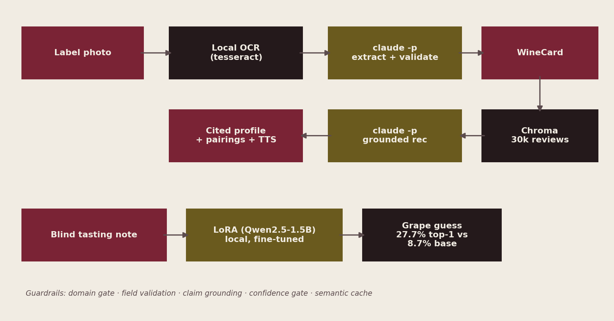

# Cellar Scanner

Photograph a wine label and get a profile and food pairings grounded in 30,000 Wine Enthusiast reviews, plus a locally fine-tuned LoRA model that guesses the grape from a blind tasting note.

[Live site](https://lyhjeremy.github.io/cellar-scanner/) · [Write-up](https://lyhjeremy.github.io/cellar-scanner/overview/) · [Technical notes](writeup.md)

Design and copy follow [these standards](https://github.com/lyhjeremy/lyhjeremy/blob/main/DESIGN_STANDARDS.md).

## Results

Blind grape identification from a tasting note with the grape name masked, 40 varieties, held-out test split:

| System | N | Top-1 | Top-3 | Macro-F1 | Latency | Cost/1k |
|---|---|---|---|---|---|---|
| Base Qwen2.5-1.5B (no fine-tune) | 300 | 8.7% | 14.3% | 0.021 | 4.3 s | $0 |
| **+ LoRA (this project)** | 300 | **27.7%** | 27.7% | **0.253** | 10.6 s | $0 |
| Claude, zero-shot | 200 | 23.0% | **30.5%** | 0.119 | 69.6 s | Claude subscription |

- LoRA fine-tuning took Top-1 from 8.7% to 27.7%, 3.2 times the base model, and runs on a laptop with no network call.
- The LoRA model leads Claude zero-shot on Top-1 (27.7% against 23.0%) and macro-F1 (0.253 against 0.119). The two were scored on different subsamples of 300 and 200 rows, and the Top-1 gap is about 1.2 standard errors, so it is a lead that sampling noise could erase.
- Claude leads on Top-3. The LoRA model's Top-1 and Top-3 are identical because its training target was a single answer (`"1. {variety}"`), so it never fills ranks 2 and 3.

Full numbers, the confusion matrix and the dataset card are in [`eval/`](eval/), produced by [`training/bench_classifier.py`](training/bench_classifier.py).



## Method

### Classifier data

`training/prep_classifier.py` builds 41,389 rows from the 40 varieties with at least 500 reviews, capped at 1,200 per variety, split by wine title so no wine is in both train and test (37,289 train, 2,076 validation, 2,024 test; leakage check passed). A regex masks the variety name and common synonyms in every note. It fired on 20.1% of rows ([`eval/masking_report.json`](eval/masking_report.json)), which would otherwise have turned the task into string matching.

### Fine-tune

LoRA on `mlx-community/Qwen2.5-1.5B-Instruct-4bit` with `mlx_lm.lora` on Apple Silicon: 12 layers, batch 4, 800 iterations, learning rate 1.5e-4, sequence length 768. 3.96M trainable parameters (0.256%), 4.4 GB peak memory. Validation loss went from 3.895 to 1.196 ([`training/train_run.log`](training/train_run.log), [`eval/loss_curve.png`](eval/loss_curve.png)).

### Benchmark

Base and LoRA run on a seeded 300-row subsample of the test split (`mlx_lm.generate` reloads the model per call, so the full set would take hours); Claude runs on a separate 200-row subsample. Answers are matched against the class vocabulary. Metrics: Top-1, Top-3, macro-F1, latency.

### Scanner

`tesseract` OCRs the label locally. One `claude -p` call checks the photo is a wine label and extracts a structured card (producer, wine, vintage, grape, region, country, confidence). The card queries a Chroma index of 30,000 reviews, embedded with sentence-transformers and stratified across varieties by water-filling. A second call writes the profile and pairings, and a token budgeter records what went into the prompt.

### Guardrails

A domain gate refuses non-wine photos. Vintage is range-checked and the grape is validated against the winemag vocabulary. Each profile sentence and pairing reason must match a retrieved review, or it is dropped and the answer regenerates, and every citation is the id of a retrieved review. A low-confidence read asks for a retake. A semantic cache answers repeat scans, with the hit rate in the dev panel.

Stack: Python, MLX / mlx-lm, Qwen2.5-1.5B, LoRA, sentence-transformers, Chroma, tesseract, Claude CLI, Gradio, faster-whisper (speech input), edge-tts (read-back), pydantic.

## How to run

```bash
pip install -r requirements.txt
./setup_ocr.sh                      # tesseract + language packs (one-time, uses Homebrew)
python scripts/ingest.py            # builds the 30k-review index
python training/prep_classifier.py  # builds the masked classifier dataset
bash training/lora_harness/train.sh mlx-community/Qwen2.5-1.5B-Instruct-4bit \
    data/lora training/adapters 4 12 800 1.5e-4 768
python app.py                       # Gradio app: Scan a label, Blind Taste Mode
```

Generation uses `claude -p` and your Claude subscription. `.env.example` lists the optional overrides, including a `GEMINI_API_KEY` fallback and `ANTHROPIC_API_KEY` for when neither the CLI nor Gemini is available. MLX training and the LoRA model need Apple Silicon. There is no hosted demo.

## Repo layout

| Path | Purpose |
|---|---|
| `app.py` | Gradio app (Scan a label, Blind Taste Mode) |
| `scripts/ingest.py` | Builds the 30k-review stratified index |
| `scripts/make_assets.py` | Draws `assets/architecture.png` and `assets/banner.png` |
| `training/prep_classifier.py` | Masked, leakage-checked classifier dataset |
| `training/lora_harness/` | MLX LoRA training script and loss plotting |
| `training/bench_classifier.py` | Base / LoRA / Claude benchmark |
| `training/make_confusion_matrix.py` | Confusion matrix figure |
| `src/` | Scanner, vision, retriever, guardrails, context budgeter, cache, audio, LLM wrapper |
| `eval/` | Benchmark results, confusion matrix, loss curve, dataset card, masking report |
| `tests/` | Benchmark classifier tests |

## Limitations

- The LoRA and Claude rows use different subsamples, and the Top-1 gap is within sampling noise.
- The LoRA model cannot rank a second or third guess until it is retrained with ranked-list targets.
- Training saw 3,200 of the 37,289 training rows (800 iterations at batch 4).
- The labels are the dataset's variety field, which mixes grapes with blends and styles (Red Blend, Rosé, Port).
- Label reading depends on OCR quality; the confidence gate asks for a retake when the read is weak.

## License

[MIT](LICENSE) © 2026 Jeremy Lee
