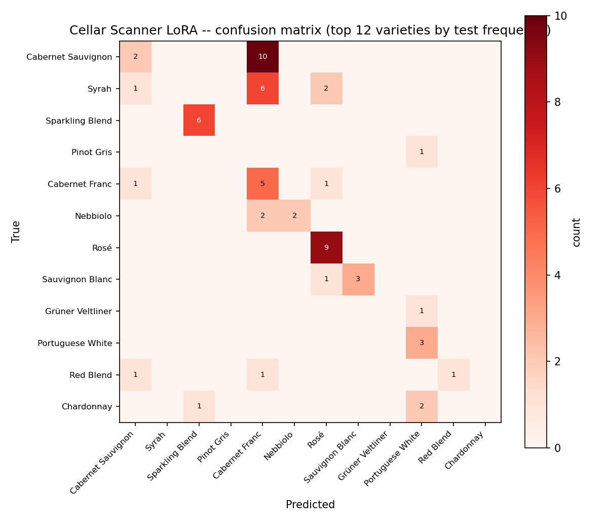

# Cellar Scanner: a wine app with no vision API key

*Photograph a label, get a grounded recommendation, and test a locally fine-tuned model that names the grape blind.*

## Why build it

Point a phone at a wine bottle and ask what to eat with it, and a chatbot will answer, possibly with a producer, a score or a tasting note it never read. Cellar Scanner reads the label, retrieves similar wines from a corpus of professional reviews, and says only what the retrieved text supports.

It was also practice for five things I wanted to show with numbers attached: fine-tuning, guardrails, multimodal input, context engineering and token budgeting. The part I find most interesting is the blind-tasting model. WSET training (I hold Level 3) teaches you to describe a wine in a fixed vocabulary; this model runs that in reverse, from the description to the grape, and a 1.5B-parameter model turns out to learn some of it on a laptop.

## No Gemini key

The original design used Gemini's vision API to read the label photo. Two API keys both had zero free-tier quota provisioned, which was a project-configuration problem; a rate limit would have cleared on its own. I made the vision step local and stopped waiting on a third key: `tesseract` OCRs the photo, then `claude -p` (my Claude subscription, no per-token API cost) checks that it is a wine label and extracts the structured fields from the OCR text in one call. It still refuses non-wine photos and flags low-confidence reads.

## The retrieval layer

The corpus is about 30,000 Wine Enthusiast reviews, embedded locally with `sentence-transformers` and indexed in Chroma as a stratified sample across every represented grape. A water-filling allocation hands unused quota from rare varieties to common ones until the 30,000 target is reached. The first version of the ingest script used a flat per-variety quota and undershot the target by two thirds; I caught it by reading the printed count.

Each claim in a generated profile or pairing is checked against the retrieved reviews before it reaches the user. Sentences that do not ground are dropped and the answer regenerates without them. Every citation is the id of a review that retrieval returned.

## The fine-tune

Given a tasting note with the grape name masked out, the model has to guess the variety. The labels come straight from the Wine Enthusiast variety field, and the dataset has 41,389 rows across the 40 varieties with at least 500 reviews, capped at 1,200 per variety, split by wine title so no wine's reviews land in both train and test.

Many descriptions name the grape ("this Cabernet shows..."), which would turn blind tasting into string matching, so I measured the masking step. Regex-masking the variety name and its common synonyms fired on 20.1% of rows: without it, one example in five would have been trivial.

A Qwen2.5-1.5B-Instruct model (4-bit MLX) was LoRA fine-tuned on the masked notes on my laptop: 800 iterations at batch 4, 12 layers, learning rate 1.5e-4, 3.96M trainable parameters, 4.4 GB peak memory. Validation loss fell from 3.895 to 1.196. It was then benchmarked three ways on the held-out, shuffled test split:

| System | N | Top-1 | Top-3 | Macro-F1 | Latency | Cost/1k calls |
|---|---|---|---|---|---|---|
| Base Qwen2.5-1.5B | 300 | 8.7% | 14.3% | 0.021 | 4.3 s | $0 |
| **+ LoRA (this project)** | 300 | **27.7%** | 27.7% | **0.253** | 10.6 s | $0 |
| Claude (teacher, zero-shot) | 200 | 23.0% | **30.5%** | 0.119 | 69.6 s | Claude subscription |

Fine-tuning lifted Top-1 3.2 times over the untrained base model. The LoRA model's Top-1 (27.7%) is ahead of Claude's zero-shot Top-1 (23.0%), at $0 marginal cost, about a seventh of the latency, and with no network call. Base and LoRA were scored on a 300-row subsample and Claude on the first 200 of those rows, so the two can be compared note by note. On the shared 200 the LoRA model was right on 55 and Claude on 46; of the 67 notes only one of them got right, the split was 38 to 29, which an exact sign test puts at p = 0.33. (An earlier version of this note called Claude's rows a separate subsample and gave a standard-error estimate; the code in `bench_classifier.py` takes `rows[:200]`.) I read it as the small specialist matching or slightly beating the generalist on the one task it was trained for, which is a narrower claim than a decisive win. The macro-F1 gap (0.253 against 0.119) is larger, which means the LoRA model's correct answers are spread across more varieties.

Claude leads on Top-3 (30.5% against 27.7%) for a specific reason, covered below: the LoRA model cannot use a second or third guess yet.

The confusion matrix (`eval/confusion_matrix.png`) shows where the fine-tuned model still struggles. Cabernet Sauvignon is called Cabernet Franc 10 times, Syrah is also pulled toward Cabernet Franc, Nebbiolo goes to Sangiovese, and a group of whites (Pinot Gris, Riesling, Grüner Veltliner, Sauvignon Blanc, Chardonnay, Portuguese White) collapses into Viognier. These are confusions a human taster could make.

  

### The Top-3 limitation

The fine-tuned model's Top-1 and Top-3 accuracy are identical. The raw generations showed why: the training target was always the single line `"1. {variety}"`, never a three-item ranked list, so the model learned to answer once and stop. It reproduces its training signal correctly, and that signal never asked for a ranking. A retrain with multi-item targets would close this gap.

## Context engineering and token budgeting

Every request goes through a token budgeter that reports what made it into the prompt: system rules, the wine card, the top-*k* retrieved reviews (rank-ordered, and cut at a whole item so no review ends mid-sentence), and the output format. The app's dev panel shows this breakdown.

Re-scanning the same bottle hits a semantic cache keyed on the extracted card, which returns the earlier answer without a new retrieval and generation round trip. The dev panel shows the hit rate.

## What building this taught me

The useful lessons came from the parts that did not work the first time:

- The wine index undershot its 30,000 target by two thirds on the first run. Reading the printed count caught it; a water-filling allocation fixed it.
- The first benchmark had Claude scoring below the untrained base model. That was a parsing bug: markdown-wrapped answers failed an exact string match. Matching against the known class vocabulary fixed it.
- The confusion matrix, made as a nice-to-have figure, showed that the test subsample covered only 6 of the 40 varieties. The test file was not randomly ordered and the benchmark took the first N rows. A seeded shuffle fixed it (40 of 40 varieties in the 300-row subsample), and the corrected rerun changed the headline: the LoRA model went from recovering 67% of the teacher's accuracy to leading it on Top-1. The unshuffled run had been measuring an easier six-variety task and reporting it as a 40-variety result.

None of these would have shown up in code review. Each came from running the pipeline and treating a suspicious number as a bug report.

## Limitations

- The Top-1 gap between the LoRA model and Claude is within sampling noise (sign test p = 0.33 on 200 shared notes).
- Training saw 3,200 examples (800 iterations at batch 4) of the 37,289-row training split.
- The variety labels mix grapes with blends and styles (Red Blend, Rosé, Port).
- MLX training and the LoRA model need Apple Silicon, and there is no hosted demo.

---

*Built by [Jeremy Lee](https://github.com/lyhjeremy). Code, benchmark and dataset card: [github.com/lyhjeremy/cellar-scanner](https://github.com/lyhjeremy/cellar-scanner).*
